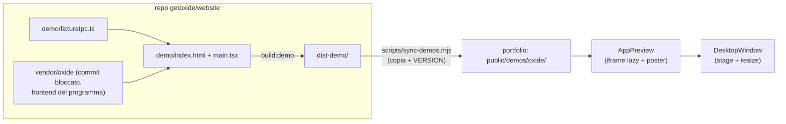

# ANTEPRIME_FINESTRE.md: anteprime interattive e ridimensionamento delle finestre

> **Stato:** è solo una proposta, non è stato scritto codice.
> **Ambito:** le finestre a fianco dei progetti (pannelli 03 Oxide, 04 SyncForge, 05 scrobbl.rs), cioè
> [`ResizableWindow`](src/components/InteractiveAppMockup.tsx#L31-L325) e i tre mockup in
> [InteractiveAppMockup.tsx](src/components/InteractiveAppMockup.tsx).
> Si parte da **Oxide**; SyncForge e scrobbl.rs seguono lo stesso schema (vedi §5).

---

## 0. In breve

1. **Anteprima:** non ricostruire Oxide a mano. Si incorpora il **frontend vero di Oxide**, compilato in modalità demo con un **finto backend IPC** (fixture), dentro un `<iframe>` nella finestra.
   Oxide lo fa già: [`web/scripts/ui-review.mjs`](../../projects/getoxide/oxide/web/scripts/ui-review.mjs) avvia il frontend reale con fixture IPC deterministiche. `public/oxide-thread.png` è stato generato così.
   Si ottiene la UI identica, la lista thread cliccabile, il **model picker vero** che si apre, e il layout responsive di Oxide che si adatta quando la finestra cambia dimensione.
2. **Ridimensionamento:** la finestra non deve più stare nel flusso della pagina. Serve uno **"stage"** (una scrivania) di dimensione fissa nel layout. La finestra è posizionata in modo assoluto dentro lo stage, i suoi bordi sono vincolati ai bordi dello stage e la si trascina con Pointer Events e pointer capture. Il contenuto viene **riflesso o scalato** con una formula precisa (§4.5).

---

## 1. Cosa non va oggi

### 1.1 Anteprime

| Problema | Dove |
|---|---|
| Il mockup **non somiglia a Oxide**: tre colonne inventate, "Claude 3.5 Sonnet", diff finti, bottoni "Quick Action: cargo fmt". L'app vera (vedi `public/oxide-thread.png`) ha sidebar Threads, header del thread, conversazione, composer con chip `Sonnet · Medium` e pannello Diff. | [`OxideInteractiveMockup`](src/components/InteractiveAppMockup.tsx#L743-L1008) |
| Il **model picker non esiste**: il modello è solo testo. | idem |
| Toast e log finti ("28 tests passed", "Committed & pushed"): sono esattamente il "rumore" che [PROTOTIPI.md](PROTOTIPI.md) §0 chiede di eliminare. | idem |
| A 700 px tre colonne fisse non ci stanno: testi a `0.62rem`, troncamenti, nessun adattamento quando la finestra si stringe. | `.ox-*` in [index.html](index.html#L811-L960) |
| ~1200 righe di JSX con hex inline, `style={{…}}` e `<Text as="span">` usati come `div`, in contrasto con le regole Astryx di `AGENTS.md`. Ogni modifica all'app vera richiede di riallineare il mockup a mano. | tutto il file |

### 1.2 Ridimensionamento (bug concreti)

| # | Sintomo | Causa |
|---|---|---|
| R1 | **La finestra "scappa"**: allungando il bordo inferiore si sposta anche quello superiore. | La finestra sta nel flusso. Quando cambia `height`, cambia l'altezza della colonna e [`.livrea-project-split-layout`](index.html#L408-L417) (`align-items: center` + `margin-block: auto`) **ricentra** tutto. |
| R2 | **La pagina salta** durante o dopo il resize. | Il pannello cambia altezza dentro uno scroller `scroll-snap-type: y mandatory` ([index.html](index.html#L95-L104)), quindi il browser ri-aggancia lo snap. |
| R3 | **Zona morta**: tirando a destra oltre la colonna la finestra non cresce più, e tornando indietro non risponde finché non si "recupera" la differenza. | `width: size.width` + `maxWidth: '100%'` ([riga 223](src/components/InteractiveAppMockup.tsx#L223)): lo stato cresce fino a `maxWidth=860`, ma il box visivo è limitato dalla colonna (`max-width: 840px`). Stato e realtà divergono. |
| R4 | Il resize dal **bordo sinistro o superiore** sposta male la finestra. | `nextX = startRight - nextW` usa la larghezza dello stato, non quella visiva limitata ([righe 126–129](src/components/InteractiveAppMockup.tsx#L126-L129)). |
| R5 | La finestra si può **trascinare ovunque**, sopra il testo di sinistra o fuori dallo schermo, e non si ritrova più. | `transform: translate(pos)` senza alcun vincolo ([righe 101–108](src/components/InteractiveAppMockup.tsx#L101-L108)). |
| R6 | "Massimizza" (verde / doppio clic) non massimizza davvero. | Imposta `maxWidth=860`, che poi viene tagliato da `max-width: 100%` (come R3). |
| R7 | Su touch, resize e drag si scontrano con lo scroll della pagina, e la titlebar non si trascina. | `touchmove` registrato `passive: false` ma senza `preventDefault`, niente `touch-action: none`, la titlebar non ha `onTouchStart`. |
| R8 | Lag ed effetti a scatti con contenuti pesanti. | `setState` a ogni `mousemove`: ogni movimento ri-renderizza l'intera app finta. |
| R9 | Con un iframe dentro (necessario per §2) il drag **si blocca** appena il puntatore passa sopra l'app. | Gli eventi `mousemove` sopra un iframe vanno al documento dell'iframe. Non si usa pointer capture e non c'è uno "scudo". |
| R10 | Le maniglie sporgono di 6–8 px fuori dal bordo: sono difficili da trovare e vengono tagliate da qualsiasi `overflow: hidden` di un antenato. | [CSS maniglie](index.html#L526-L597) con offset negativi. |
| R11 | Pallini rosso/giallo/verde non usabili da tastiera. | Sono `<Text as="span" onClick>`, non bottoni ([righe 256–282](src/components/InteractiveAppMockup.tsx#L256-L282)). |
| R12 | Freccia su/giù dentro l'app (es. nel model picker) **fa scorrere la pagina**. | Il gestore globale `keydown` in [LivreaPortfolio.tsx](src/components/LivreaPortfolio.tsx#L110-L125) ignora solo `input`/`textarea`. |
| R13 | Non si può selezionare testo dentro l'app. | `user-select: none` su tutta la finestra (`.livrea-os-window`). |

---

## 2. Anteprime: le opzioni

| | **A. Frontend vero + IPC finto, in iframe** *(consigliata)* | B. Replica leggera scritta a mano | C. Video/GIF con hotspot |
|---|---|---|---|
| Fedeltà | Identica (è il codice vero) | Dipende dalla cura, deriva nel tempo | Identica ma non interattiva |
| Thread cliccabili, model picker | Sì, comportamento vero | Da riscrivere | No |
| Si adatta al resize | Sì, `workspaceLayout()` di Oxide riflette i pannelli | Da scrivere | No |
| Peso | ~235 KB gzip JS + ~25 KB CSS, caricati **solo** quando il pannello è vicino | ~20–30 KB | 1–3 MB |
| Manutenzione | Si ricompila la demo quando cambia Oxide | Riallineamento manuale | Si rigira il video |
| Regole Astryx | Non coinvolte: la demo è un'app statica separata in `public/` | Imitare Oxide senza `div`/hex è innaturale | Ok |
| Rischio | Accoppiamento al frontend di Oxide (commit bloccato), fixture da mantenere | Sembra "finta", è ciò che non va oggi | Troppo passiva |

**Scelta: A.** Come ripiego (ad esempio se il frontend del programma non si riesce a includere come sorgente) resta B, limitata a sidebar con 3 thread, header, 2 messaggi e composer con model picker, copiando i token CSS di Oxide (`--fg`, `--dim`, `--radius-control`…) dentro un CSS scoped della demo.

---

## 3. Architettura dell'opzione A (Oxide)



### 3.1 Dove sta la demo

La demo vive nel **repo del sito di Oxide** (`getoxide/website`), **non** nel repo del programma (`getoxide/oxide`), che non viene modificato. Oggi `website` contiene solo documentazione (`docs/spec`, `docs/adr`, nessun codice): la demo sarebbe il primo codice del repo, quindi va allineata a `docs/spec/design.md` e `docs/spec/budgets.md` (da leggere prima di iniziare).

- **Nel repo `website`**:
  - `demo/fixtureIpc.ts`: la fixture IPC (shim di `window.__TAURI_INTERNALS__` e `__TAURI_EVENT_PLUGIN_INTERNALS__`), scritta qui partendo da quella inline in `ui-review.mjs` del repo Oxide, che resta com'è.
  - `demo/index.html` + `demo/main.tsx`: installano la fixture **prima** di importare `App`, poi fanno il render come il `main.tsx` di Oxide.
  - `demo/vite.config.ts`: alias `@oxide` verso `web/src` del repo Oxide, `base: './'`, output `dist-demo/`; script `"build:demo"`.
  - **Come entra il codice dell'app:** il frontend di Oxide si prende come sorgente **bloccato a un commit** (git submodule o checkout in CI in `vendor/oxide`), senza copiarlo e senza modificarlo. Il commit usato finisce in `VERSION`.
  - Rischio: `bindings.ts` e i nomi dei comandi IPC possono cambiare tra versioni di Oxide. Per questo il commit è bloccato e si aggiorna in modo esplicito (la fixture risponde `null` ai comandi sconosciuti, vedi §3.2).
- **Nel portfolio**: `scripts/sync-demos.mjs` copia `dist-demo/` (build di `website`) in `public/demos/oxide/`. Gli asset compilati vanno committati, così il deploy Cloudflare non dipende da nessun altro repo.

Se `website` pubblicherà la demo anche sul proprio sito, il portfolio può in futuro puntare a quell'URL invece di copiare i file.

### 3.2 Scenario fixture "portfolio"

Si parte dalla fixture esistente e si cambia solo questo:

| Cosa | Contenuto |
|---|---|
| Progetto | `oxide` in `~/Developer/projects/oxide`, branch `fix/desktop-ui-consistency`, `+42 −12` |
| **3 thread**, uno per provider (così cambiando thread cambia anche il chip del modello) | 1. *Review desktop interface consistency*: `claude` / `claude-sonnet-4-6` / medium / completed<br>2. *Improve keyboard navigation*: `codex` / modello GPT del catalogo / high / needs-input (mostra un'approval)<br>3. *Check Git worktree cleanup*: `antigravity` / modello Gemini / low / working |
| Conversazione per thread (`subscribe_thread`) | 1 prompt utente + 1 risposta breve e **credibile**, in inglese, diversa per thread |
| `detect_provider` | tutti e 3 `installed + authenticated` |
| `get_model_catalog` | per provider 2–3 modelli con `supportedEfforts`, così le tab del picker si popolano (oggi la fixture ha solo Sonnet) |
| `set_thread_model_and_effort`, `set_thread_permission_mode`, `set_favourite_models` | aggiornano lo stato in memoria, così la scelta nel picker **resta** |
| `send_prompt` *(fase 2)* | aggiunge il turno e dopo ~600 ms emette via callback evento una risposta fissa ("This is a live demo: the agent runs on your machine. Get Oxide on GitHub."). Se non lo si fa, il composer resta usabile ma l'invio è disabilitato con tooltip "Demo". |
| Azioni con effetti reali (Commit & Push, apri cartella, terminale, PR, Settings…) | no-op che restituiscono successo, oppure toast "Not available in the demo" |
| **Comandi sconosciuti** | in modalità demo restituiscono `null` con un `console.debug` invece di lanciare (oggi `ui-review` fa `throw`, va bene per i test ma rompe la demo appena Oxide aggiunge un comando) |

Stato iniziale: pannello **Tools chiuso** e terminale non avviato, quindi Monaco/xterm (chunk lazy da MB) non vengono mai scaricati. In `demo/main.tsx` si salta `highlighter()` (worker Shiki ~200 KB), oppure lo si avvia solo al primo blocco di codice.

**Budget:** carico iniziale della demo ≤ 300 KB gzip (oggi `index.js` pesa 234 KB gzip e il CSS ~25 KB). Font: Inter + JetBrains Mono, solo il subset latin.

### 3.3 `localStorage` e isolamento

- L'iframe è **same-origin**. Non usare `sandbox` senza `allow-same-origin`: Oxide accede a `localStorage` in più punti e in un'origine opaca alcuni accessi lancerebbero eccezioni.
- All'avvio `demo/main.tsx` cancella le chiavi `oxide.*` e `oxide:*`, così ogni visita parte pulita e le chiavi non si accumulano nell'origine del portfolio.

### 3.4 Il componente nel portfolio: `AppPreview`

Va dentro la finestra (§4) al posto di `{children}`:

- Prima mostra il **poster** (`/oxide-thread.png`, stesso rapporto). Un `IntersectionObserver` (`rootMargin` ≈ 1 viewport) monta l'`<iframe src="/demos/oxide/index.html" title="Oxide live demo">` quando il pannello si avvicina. Il poster sfuma via al messaggio `postMessage({ type: 'demo:ready' })` inviato dalla demo. Con `prefers-reduced-motion` il cambio è istantaneo.
- Protocollo `postMessage` minimo (si verifica sempre `event.origin`):
  - demo → parent: `demo:ready`
  - parent → demo: `demo:reset` (pallino rosso), che ricarica la fixture e torna al thread 1
- Il gestore tastiera globale in `LivreaPortfolio` deve uscire subito se `document.activeElement` è un `IFRAME` o sta dentro `.app-window` (risolve R12).
- **Scroll**: la rotellina sopra l'iframe scorre la conversazione di Oxide. Con la conversazione corta della fixture non c'è nulla da scorrere e lo scroll passa alla pagina. Verificare su Chrome e Safari insieme allo snap.
- **Mobile (< 1024 px o `pointer: coarse`)**: niente iframe automatico. Si mostrano poster e due azioni: **"Try it here"** (monta l'iframe scalato, §4.5) e **"Open full screen ↗"** (`/demos/oxide/` in una nuova scheda). Così l'iframe non intrappola lo scroll del dito.

### 3.5 Cosa sparisce

- `OxideInteractiveMockup` e i relativi CSS `.ox-*` in `index.html`.
- La didascalia sotto la finestra diventa una riga sola: *"Live demo of the real Oxide UI · sample data"*. Niente più "drag titlebar to move · run pre-merge gate".

---

## 4. Ridimensionamento: nuovo design

### 4.1 Lo stage

```
┌─ colonna destra ────────────────────────────────┐
│ ┌─ stage (dimensione fissa, nel flusso) ──────┐ │
│ │      ┌─ finestra (absolute) ───────┐        │ │
│ │      │ ● ● ●  Oxide                │        │ │
│ │      │                             │        │ │
│ │      └─────────────────────────────┘        │ │
│ └─────────────────────────────────────────────┘ │
│ didascalia                                      │
└─────────────────────────────────────────────────┘
```

- Lo **stage** ha `position: relative; width: 100%`. L'altezza è stabile e **non dipende dalla finestra**: ad esempio `height: min(72svh, 640px)` (in pratica un token o un valore del tema, niente px nei componenti), dimensionata perché il pannello stia in 100 vh. Risolve R1 e R2: niente ricentramento e niente ri-snap, perché il layout non cambia mai durante il resize.
- La **finestra** ha `position: absolute`, con geometria `{ left, top, width, height }` in px **relativi allo stage**, applicata con `transform: translate3d(left, top, 0)` + `width`/`height`.
- Un `ResizeObserver` sullo stage fornisce `stageW`/`stageH`. Quando lo stage cambia (resize del browser), la geometria viene **ri-vincolata**: la finestra si rimpicciolisce o si sposta per restare dentro, mai fuori.
- Valutare il passaggio di `.livrea-snap-container` da `mandatory` a `proximity`: con contenuti interattivi `mandatory` è aggressivo. Il guadagno principale però viene già dallo stage.

### 4.2 Modello geometrico: bordi, non posizione + dimensione

La logica sta in una funzione **pura** e testabile, senza DOM:

```ts
type Dir = 'n' | 's' | 'e' | 'w' | 'ne' | 'nw' | 'se' | 'sw' | 'move';
type Rect = { left: number; top: number; right: number; bottom: number };
type Limits = { stageW: number; stageH: number; minW: number; minH: number };

function applyDrag(start: Rect, dir: Dir, dx: number, dy: number, L: Limits): Rect {
  let { left, top, right, bottom } = start;
  if (dir === 'move') {
    const w = right - left, h = bottom - top;
    left = clamp(left + dx, 0, L.stageW - w);
    top  = clamp(top  + dy, 0, L.stageH - h);
    return { left, top, right: left + w, bottom: top + h };
  }
  if (dir.includes('w')) left   = clamp(start.left   + dx, 0, start.right  - L.minW);
  if (dir.includes('e')) right  = clamp(start.right  + dx, start.left + L.minW, L.stageW);
  if (dir.includes('n')) top    = clamp(start.top    + dy, 0, start.bottom - L.minH);
  if (dir.includes('s')) bottom = clamp(start.bottom + dy, start.top  + L.minH, L.stageH);
  return { left, top, right, bottom };
}
```

- Ogni bordo si muove **da solo** ed è vincolato allo stage e alla dimensione minima. Il bordo opposto resta fermo per costruzione (risolve R4).
- Si calcola sempre da `start` + delta totale (mai incrementale), quindi non c'è deriva.
- **Non esiste un `maxWidth` separato**: il massimo è lo stage. Lo stato coincide sempre con ciò che si vede (risolve R3 e R6).
- Limiti iniziali: `minW = 360`, `minH = 240`. Geometria iniziale: centrata, 100% della larghezza dello stage × 100% dell'altezza meno un margine, cioè "quasi massimizzata", perché la demo deve essere leggibile subito.

### 4.3 Input: Pointer Events

- `pointerdown` su maniglia o titlebar: `el.setPointerCapture(e.pointerId)`, salvataggio di `start` e del punto iniziale. Poi `pointermove` / `pointerup` / `pointercancel` **sullo stesso elemento**. Un solo percorso per mouse, touch e penna (risolve R7). Niente listener su `window`.
- `touch-action: none` su maniglie e titlebar.
- **Scudo iframe**: durante il drag si aggiunge `data-dragging` alla finestra, e il CSS mette `pointer-events: none` sull'iframe e il cursore giusto sullo stage. La pointer capture da sola in alcuni browser non basta sopra un iframe (risolve R9).
- **Prestazioni**: durante il drag si scrive la geometria in un `ref` e la si applica in `requestAnimationFrame` direttamente su `style` (`transform`, `width`, `height`). Lo stato React si aggiorna solo a `pointerup`. L'iframe non ri-renderizza niente lato React (risolve R8). Il contenuto dell'iframe riceve un normale `resize` di viewport, come una finestra vera.
- Si usa `user-select: none` **solo durante il drag** (sul `body`), non sempre (risolve R13).

### 4.4 Maniglie e controlli

- Maniglie **dentro** il bordo, non fuori (risolve R10): bordi spessi 6 px, angoli 14×14 px, sopra il contenuto (`z-index`) ma trasparenti. Una piccola **grip visibile** nell'angolo SE come affordance. Hover: cursore giusto e un bordo accent sottile.
- Titlebar: trascinabile (se si tiene il move, vedi §6), doppio clic per massimizza/ripristina.
- Pallini come **veri `<button>`** con `aria-label` e focus visibile (risolve R11):
  - rosso: *Reset*, cioè geometria iniziale + `demo:reset` all'iframe
  - giallo: *Compact*, preset 60% dello stage (utile a mostrare che Oxide nasconde la sidebar quando si stringe)
  - verde: *Fill*, riempie lo stage; un secondo clic ripristina la geometria precedente
- Le transizioni dei preset (`transform`/`width`/`height` 180 ms) sono disattivate con `prefers-reduced-motion` e **mai** attive durante il drag.
- Tastiera *(fase 3)*: la grip SE è focusabile e le frecce ridimensionano di 16 px (con Shift 64 px), sempre tramite `applyDrag`. La titlebar è focusabile e Alt+frecce la spostano.
- Via l'etichetta `[DRAG TITLEBAR TO MOVE]` e l'indicatore delle dimensioni: le affordance (cursori, grip) bastano.

### 4.5 Contenuto: riflettere o scalare

Il frontend di Oxide è responsive: in [`panelLayout.ts`](../../projects/getoxide/oxide/web/src/panelLayout.ts) servono `centreMin 360` + `sidebarMin 160` per sidebar + conversazione, e altri `TOOLS_MIN 496` per il pannello Diff. Quindi:

```
vw, vh  = dimensioni interne della finestra (sotto la titlebar), dal ResizeObserver
LOGICAL_MIN_W = 760, LOGICAL_MIN_H = 480     // sotto questi valori Oxide sembrerebbe "mobile"
scale   = min(1, vw / LOGICAL_MIN_W, vh / LOGICAL_MIN_H)
iframe.style.width  = vw / scale
iframe.style.height = vh / scale
iframe.style.transform = `scale(${scale})`; transform-origin: 0 0
```

- **Finestra grande (≥ 760 px)**: scala 1, l'app **riflette** davvero. Allargando compaiono sidebar e Diff, stringendo spariscono, esattamente come la finestra Tauri vera. È l'effetto "wow" del resize.
- **Finestra piccola o mobile**: l'app viene **scalata** in proporzione invece di rompersi.
- Sostituisce l'attuale `overflow: hidden` + layout fissi che tagliano il contenuto.

### 4.6 API proposta (modulo profondo, interfaccia piccola)

```tsx
// src/components/desktop/DesktopWindow.tsx
<DesktopStage>                          // misura lo stage, fornisce i limiti
  <DesktopWindow
    title="Oxide"
    icon="/oxide-icon.svg"
    onReset={() => previewRef.current?.reset()}
  >
    <AppPreview ref={previewRef} src="/demos/oxide/index.html" poster="/oxide-thread.png" />
  </DesktopWindow>
</DesktopStage>
```

- `src/components/desktop/geometry.ts`: `applyDrag`, `clampToStage`, i preset; puro, con test unitari.
- `src/components/desktop/useWindowDrag.ts`: pointer capture, rAF, scudo iframe.
- `DesktopWindow.tsx`: chrome (titlebar, pallini, maniglie). Senza `<div>`: `VStack`/`HStack` e CSS solo per posizionamento e maniglie, colori da token (`var(--color-*)`).
- `AppPreview.tsx`: poster, lazy iframe, scala (§4.5), `postMessage`.
- `ResizableWindow` e `InteractiveAppMockup.tsx` vengono eliminati a migrazione finita.

### 4.7 Mobile e touch

Sotto 1024 px o con `pointer: coarse`: **niente move e niente resize**. Lo stage diventa un box statico a tutta larghezza con rapporto 16:10, e la finestra lo riempie. Il contenuto è il poster con "Try it here" / "Open full screen" (§3.4). Su un telefono il resize non ha senso e combatte con lo scroll.

---

## 5. SyncForge e scrobbl.rs (stesso schema, fase 4)

| Progetto | Come si inietta il backend finto |
|---|---|
| **SyncForge** | [`web/src/bridge.js`](../../projects/personal/SyncForge/web/src/bridge.js) supporta già un'API mock tramite `window.pywebview.api`. La entry demo definisce quell'oggetto con risposte fisse (file caricato, tracce, offset calcolato dopo un breve ritardo). Non serve toccare `__TAURI_INTERNALS__`. |
| **scrobbl.rs** | Il frontend usa `fetch("/api/…")` (`frontend/src/api.ts`). La entry demo sostituisce `window.fetch` per i path `/api/*` con JSON statici (dashboard, top artists, periodi). In alternativa si usano JSON generati da un DB di esempio. Verificare se i test Playwright del repo hanno già fixture riusabili. |

Stesso flusso: `build:demo` nel repo del progetto, `sync-demos.mjs`, `public/demos/<nome>/`, `AppPreview`.

---

## 6. Decisioni prese

1. **Dove sta la demo:** nel repo del **sito** di Oxide (`getoxide/website`), non nel repo del programma. Il programma non viene toccato.
2. **Spostamento della finestra:** sì, mantenuto, sempre vincolato ai bordi dello stage (§4.2 `move`). Il doppio clic sulla titlebar e il pallino verde riempiono lo stage.
3. **Invio prompt nella demo:** sì, con risposta fissa. Passa dalla fase 3 alla fase 2 (`send_prompt` in §3.2 non è più facoltativo).
4. **Mobile:** sì, poster con "Try it here" / "Open full screen" (§3.4 e §4.7).

Non ci sono decisioni aperte. Il piano è pronto da eseguire, ma non è stato avviato nessun lavoro sul codice.

---

## 7. Piano di lavoro e criteri di accettazione

| Fase | Lavoro | Fatto quando |
|---|---|---|
| **1. Finestra** | `geometry.ts` (+ test), `useWindowDrag`, `DesktopStage`/`DesktopWindow`; i tre mockup attuali entrano nella nuova finestra senza modifiche. | Tutti gli 8 bordi e angoli arrivano al limite dello stage e tornano indietro **senza zona morta**. Il bordo opposto non si muove mai di 1 px. La pagina non salta durante o dopo il resize (con snap attivo). Nessuno scroll orizzontale a 1024, 1280, 1440 e 1920 px. Pallini usabili da tastiera. |
| **2. Demo Oxide** | Fixture estratta + scenario portfolio, `build:demo`, `sync-demos.mjs`, `AppPreview` con poster e lazy iframe. | Clic su un thread: cambia conversazione e chip del modello. Clic sul chip modello: si apre il picker vero con le tab Claude/Codex/Antigravity, e la scelta resta. Nessun errore in console. Resize sopra l'iframe fluido. Lighthouse della home ancora ≥ 95 (iframe lazy). |
| **3. Rifiniture** | Resize da tastiera, `demo:reset`, reduced motion, comportamento mobile. | Checklist a11y (focus, `title` dell'iframe, contrasto); controllo su Safari e Chrome, desktop e iPhone. |
| **4. Altri progetti** | SyncForge e scrobbl.rs con lo stesso schema; eliminazione di `InteractiveAppMockup.tsx` e dei CSS `.sf-*`, `.ox-*`, `.sc-*`. | `npx astryx doctor --built dist` verde. |

**Test minimi per `applyDrag`:** per ogni direzione, (a) delta positivo e negativo, (b) delta oltre il limite dello stage, (c) delta oltre la dimensione minima, (d) `move` vincolato ai 4 lati, (e) ri-vincolo dopo che lo stage si rimpicciolisce.
